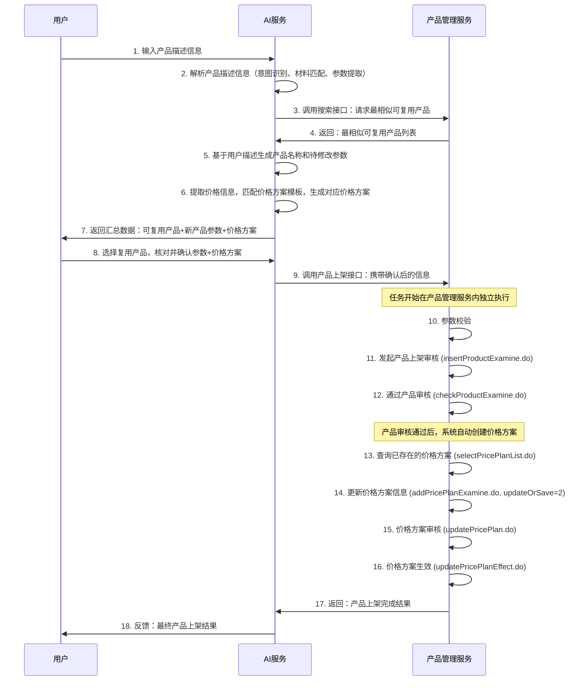

## 流程说明

### 第一阶段：用户输入→AI解析+汇总数据

1. **用户输入产品描述信息**
   - 用户通过 `/api/chat` 接口输入自然语言描述
   - 例如："兰溪，M323H，BC瓦，牌价2.75元起"

2. **AI解析产品描述信息**
   - 意图识别：判断输入是否与产品上架相关
   - 材料代码匹配：从用户输入中匹配材料代码（如 M323H）
   - 参数提取：提取楞型（如 BC瓦）、层数等信息

3. **调用搜索接口查询可复用产品**
   - 根据提取的参数（楞型、层数、材料代码）查询相似产品
   - 调用产品管理服务的搜索接口

4. **返回可复用产品列表**
   - 返回最相似的3个可复用产品（完整产品参数）

5. **生成产品名称和待修改参数**
   - 基于用户描述和供应商命名规则生成产品名称
   - 提取价格信息（价格类型、价格数值、起订量等）

6. **生成价格方案**
   - 从Excel模板中匹配价格方案规则
   - 根据供应商、材料代码、楞型等信息生成完整价格方案

7. **返回汇总数据**
   - 可复用产品列表（完整产品参数）
   - 新生成产品的简化数据（产品名称、材料代码、价格、起订量）
   - 完整价格方案参数

---

## 供应商选择逻辑

### 自动主供应商选择

当 `/api/chat` 接口不传 `supplierId` 参数时，系统会自动选择主供应商：

**流程**：
1. 调用 `getSupplierInfoNoAuth` 接口获取供应商列表
2. 从列表中筛选 `salesMain='y'` 的主供应商
3. 使用主供应商的 supplierId 进行后续处理

**代码示例**：
```python
# chat.py
supplier_id = request.supplierId if request.supplierId else None
# None = 自动选择主供应商

# helpers.py
if supplier_id is None:
    # 自动选择 salesMain='y' 的主供应商
    for supplier in supplier_list:
        if supplier.get("salesMain") == "y":
            matched_supplier = supplier
            break
```

### Excel 配置匹配与降级处理

系统需要在 Excel 配置文件（`doc/纸板电商供应商信息标准化模板.xlsx`）中查找供应商的产品命名规则和价格方案：

**匹配策略**（按优先级）：
1. **ID 匹配**：使用 API 返回的 supplierId 在 Excel 的 "id" 列中匹配
2. **名称匹配**：ID 匹配失败时，使用 supplierName 在 "供应商名称" 列中匹配
3. **默认规则**：完全找不到时，使用系统默认命名规则

**降级处理**：
```python
if not supplier_data:
    # 使用默认命名规则，确保系统可用性
    return {
        'product_naming_rules': DEFAULT_PRODUCT_NAMING_RULES,
        'product_naming_examples': DEFAULT_PRODUCT_NAMING_EXAMPLES,
        'is_default': True
    }
```

### 默认产品命名规则

当 Excel 中找不到供应商配置时，系统使用以下默认规则：

**命名格式**：
```
{材料代码}{楞型}瓦{层数}层纸箱
```

**示例**：
- `M323H BC瓦5层` → `M323H BC瓦5层纸箱`
- `M250H BE瓦3层` → `M250H BE瓦3层纸箱`
- `M323H 5层` → `M323H 5层纸箱`（无楞型时）

**配置位置**：`config/config.py` 中的 `DEFAULT_PRODUCT_NAMING_RULES` 常量

---

### 第二阶段：用户确认→AI发起上架

8. **用户选择复用产品，核对并确认参数+价格方案**
   - 前端展示汇总数据
   - 用户选择复用产品或使用新生成的产品
   - 用户核对并修改参数和价格方案

9. **调用产品上架接口**
   - 调用 `/api/onshelf` 接口
   - 携带确认后的产品数据和价格方案

### 第三阶段：产品管理服务执行上架流程

10. **参数校验**
    - 调用 `easyOrderAddProductCheck` 接口校验产品数据和价格方案

11. **发起产品上架审核**
    - 调用 `insertProductExamine.do` 接口
    - 发起产品上架审核流程

12. **通过产品审核**
    - 调用 `checkProductExamine.do` 接口
    - 审核状态设置为 6（上架审核通过）
    - **重要**：产品审核通过后，系统会自动创建价格方案

13. **查询已存在的价格方案**
    - 调用 `selectPricePlanList.do` 接口
    - 通过产品ID查询系统自动创建的价格方案
    - 获取价格方案的UUID

14. **更新价格方案信息**
    - 将传入的价格方案信息合并到查询出的价格方案中
    - 调用 `addPricePlanExamine.do` 接口
    - **关键**：设置 `updateOrSave=2` 表示更新（新增和编辑是同一个接口）

15. **价格方案审核**
    - 调用 `updatePricePlan.do` 接口
    - 审核状态设置为 1（通过）

16. **价格方案生效**
    - 调用 `updatePricePlanEffect.do` 接口
    - 使价格方案生效

17. **返回产品上架完成结果**
    - 包含产品ID、价格方案ID、执行步骤等信息

18. **反馈最终产品上架结果**
    - 返回给前端，展示给用户

## 重要说明

### 供应商选择规则

- **传参优先**：接口传入 `supplierId` 时直接使用指定供应商
- **自动选择**：不传 `supplierId` 时自动选择 `salesMain='y'` 的主供应商
- **降级兼容**：Excel 配置不存在时使用默认命名规则
- **ID 转换**：API 返回的 supplierId 会转换为 Excel 中的 ID 用于后续查询

### 价格方案处理逻辑

- **产品审核通过后，系统会自动创建价格方案**
- **不是新增价格方案，而是更新已存在的价格方案**
- 流程：
  1. 产品审核通过 → 系统自动创建价格方案
  2. 查询价格方案 → 获取系统创建的价格方案UUID
  3. 更新价格方案 → 使用 `addPricePlanExamine.do` 接口，`updateOrSave=2`

### 错误处理和回滚

- 使用 **Saga 模式**实现分布式事务
- 任何步骤失败时，逆序执行已成功步骤的补偿操作
- 支持重试机制（默认最大重试3次）
